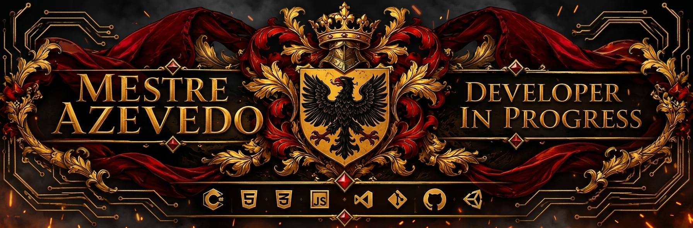

# MestreAzevedo-MestreAzevedo
Desenvolvedor em formação | Estudante de Análise e Desenvolvimento de Sistemas

Estou construindo minha jornada na programação, estudando lógica, desenvolvimento de software e explorando novas tecnologias.

###### Meu Foco Atual ######

Linguagem C e lógica de programação.

Git e GitHub.

Desenvolvimento de software.

###### Tecnologias e ferramentas ######

### Linguagens de programação ###
* C — foco atual de estudos
* HTML
* CSS
* JavaScript
* C# — em aprendizado

### Ferramentas de desenvolvimento ###
* Visual Studio Code
* Git
* GitHub
* GCC — MSYS2 UCRT64

### Conhecimentos em desenvolvimento ###
* Lógica de programação
* Estruturas condicionais
* Estruturas de repetição
* Vetores e funções em C
* Controle de versão
* Compilação e execução com GCC

###### Próximos objetivos ######
* Java
* Go
* Unity
* Desenvolvimento de jogos 2D

  
###### Projetos em desenvolvimento ######

Estudos em C — exercícios e projetos desenvolvidos durante meus estudos.

